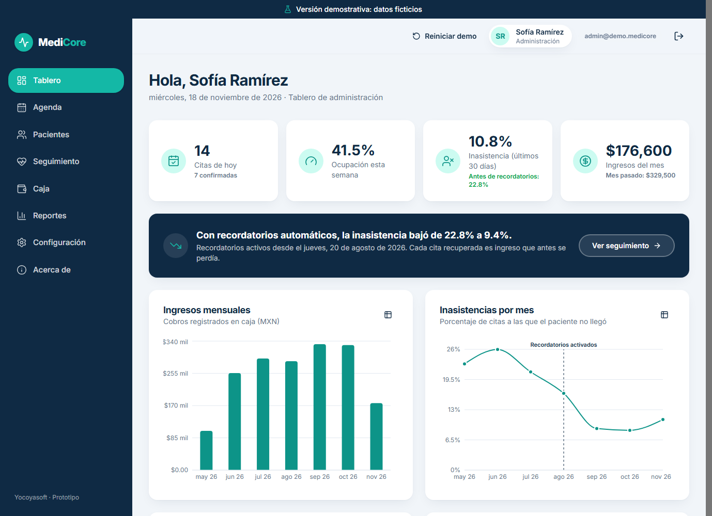
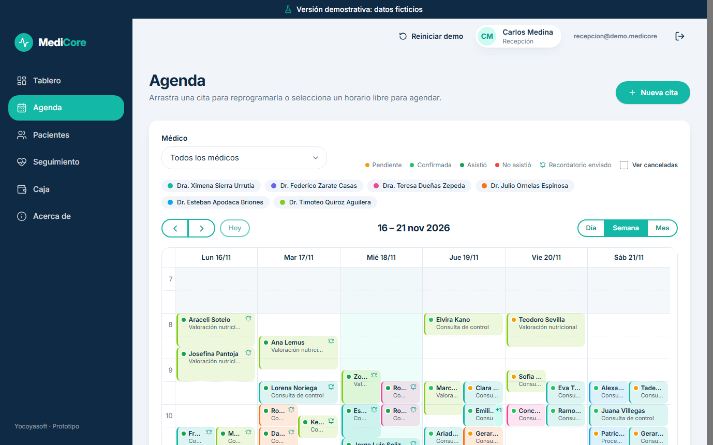
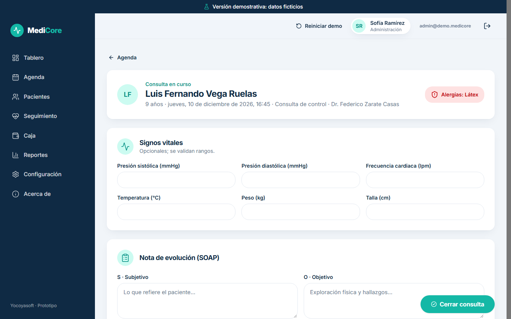
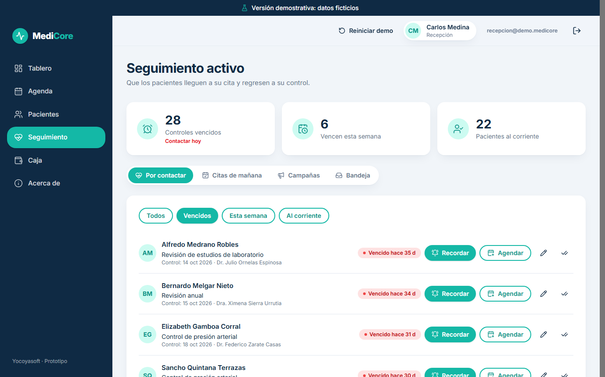
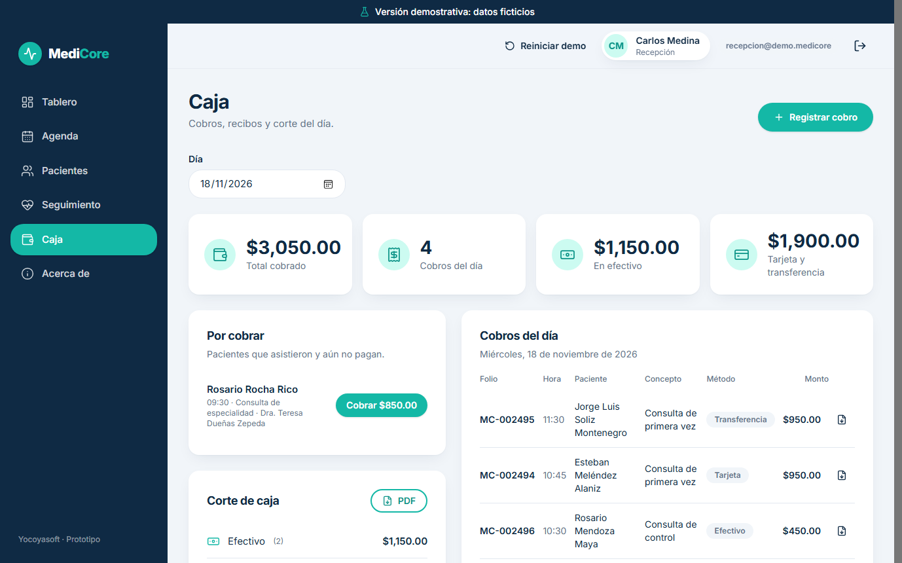
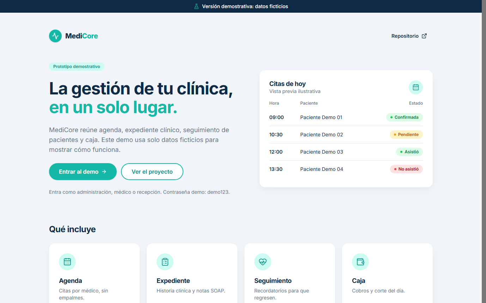
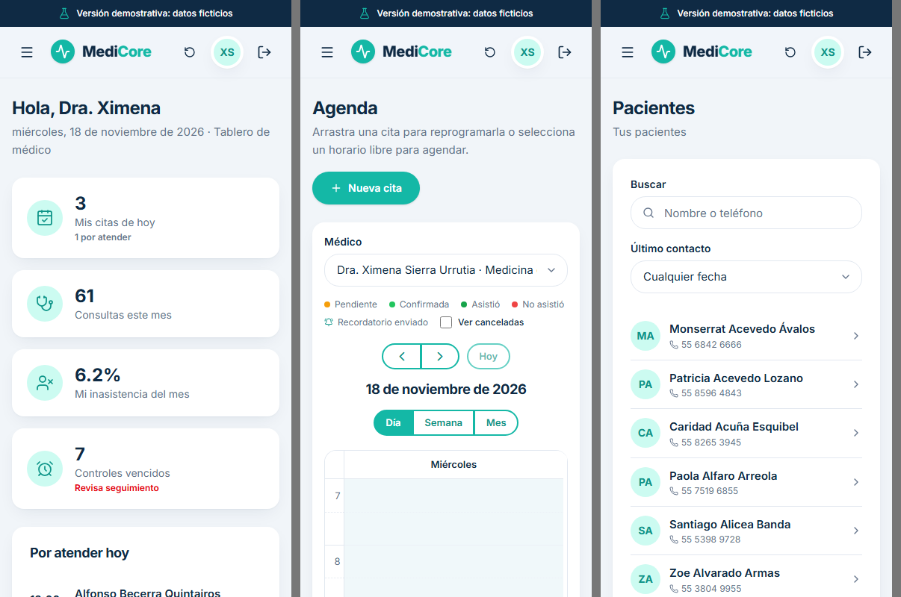

# MediCore

> ⚠️ **Prototipo demostrativo.** Todos los datos (pacientes, médicos, citas, expedientes y pagos) son **ficticios**. No se procesa ni almacena información médica real.

**MediCore** es una plataforma SaaS para la gestión integral de clínicas privadas: agenda de citas, expediente clínico electrónico, consultas, seguimiento activo de pacientes, caja y reportes. Es un proyecto de **Yocoyasoft**.

- 🌐 **Demo:** https://juandiazpro.github.io/MediCore/
- 🎤 **Guion de presentación:** [`docs/GUION-DEMO.md`](docs/GUION-DEMO.md)
- 🗺️ **Plan de construcción:** [`docs/ETAPAS.md`](docs/ETAPAS.md)
- 📄 **Documentación:** [`docs/`](docs/)



## Cómo probarlo

Entra al demo y elige un rol (la contraseña de todos es `demo123`):

| Rol            | Usuario                   | Qué puede hacer                                       |
| -------------- | ------------------------- | ----------------------------------------------------- |
| Administración | `admin@demo.medicore`     | Todo: tablero, reportes, configuración, caja y agenda |
| Médico         | `medico@demo.medicore`    | Su agenda, sus pacientes, consultas y recetas         |
| Recepción      | `recepcion@demo.medicore` | Agenda de todos, pacientes, cobros y recordatorios    |

Los cambios se guardan solo en tu navegador. El botón **Reiniciar demo** regresa a los datos de ejemplo.

## Módulos

| Módulo                | Qué muestra                                                                                  |
| --------------------- | -------------------------------------------------------------------------------------------- |
| Tablero               | Indicadores y gráficas según el rol; impacto de los recordatorios en la inasistencia         |
| Agenda                | Día, semana y mes; color por médico; arrastrar y soltar con validación de empalmes y horario |
| Pacientes             | Búsqueda, filtros, alta y edición, ficha con pestañas                                        |
| Expediente y consulta | Historia clínica, nota SOAP, CIE-10, receta en PDF, línea de tiempo y bitácora               |
| Seguimiento           | Controles vencidos, recordatorios simulados (WhatsApp, SMS, correo), campañas y bandeja      |
| Caja                  | Cobros, recibo en PDF con folio y corte del día                                              |
| Reportes              | Ingresos por médico y servicio, inasistencias por mes, exportación a PDF                     |
| Configuración         | Datos de la clínica, horarios de los médicos, servicios y precios                            |

| Agenda                              | Consulta                                    | Seguimiento                                   |
| ----------------------------------- | ------------------------------------------- | --------------------------------------------- |
|  |      |  |
| **Caja**                            | **Bienvenida**                              | **Celular**                                   |
|      |  |            |

## Correrlo en tu computadora

Requiere Node.js 22 o superior.

```bash
npm install          # instalar dependencias
npm run dev          # servidor local (http://localhost:5173/MediCore/)
npm run lint         # ESLint
npm run format       # Prettier
npm run test         # Vitest (modo watch); una sola vez: npm run test -- --run
npm run build        # build de producción en dist/
npm run preview      # previsualizar el build
```

Cada push a `main` corre lint, formato, pruebas y build en GitHub Actions y publica el demo en GitHub Pages.

## Cómo está hecho

- **Sin servidor:** una capa de servicios simulada (`src/services/*/*.mock.ts`) responde con 300 a 800 ms de latencia y guarda en `localStorage`. Para el producto real solo se cambia `src/services/index.ts`.
- **Datos semilla deterministas** con Faker `es_MX`: 1 clínica, 6 médicos, 250 pacientes y 6 meses de citas, consultas y pagos. Incluyen el escenario de la demo: la inasistencia baja de ~22 % a ~8 % al activar los recordatorios.
- **Stack:** TypeScript · React · Vite · Tailwind CSS · shadcn/ui (Radix) · Lucide · React Router (HashRouter) · TanStack Query · Zustand · React Hook Form + Zod · FullCalendar · Recharts · date-fns · jsPDF · Vitest + Testing Library · ESLint + Prettier.

## Equipo

- Chávez Martínez Adrián Uxue
- Márquez Bailón Elías Manuel
- Díaz Barroso Juan José
- Martínez Vázquez Leonardo
